# OpenRide

<p align="center">
  
</p>

OpenRide is a free, independent workout app for the Peloton Bike (Gen 2) and Bike+. It replaces the screen you normally see when you turn on the bike with a similar-feeling experience — live stats while you ride, a library of free cycling videos, workout mini-games, and a history of all your past rides — without needing a Peloton subscription.

It's installed using a free tool called [OpenPelo](https://github.com/doudar/Openpelo), which lets you add apps to the bike's tablet. This doesn't require rooting the device or unlocking anything permanently.

<p align="center">
  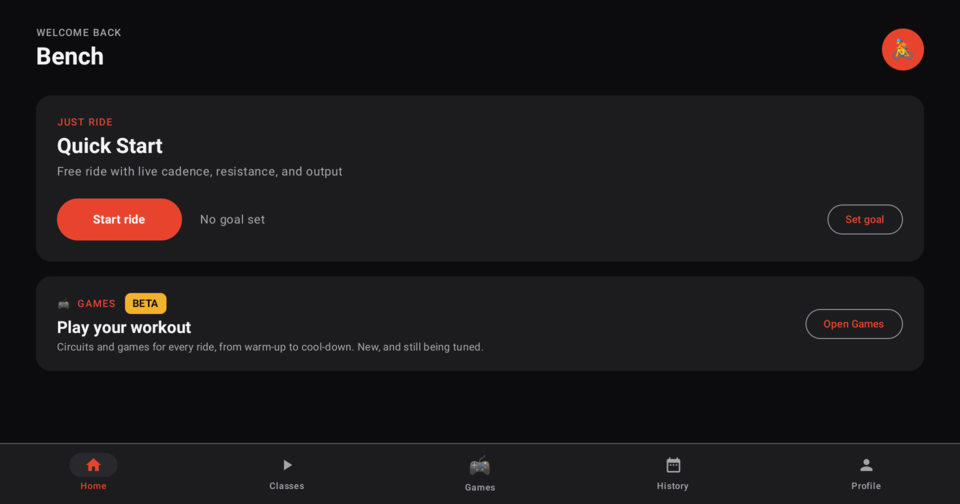
  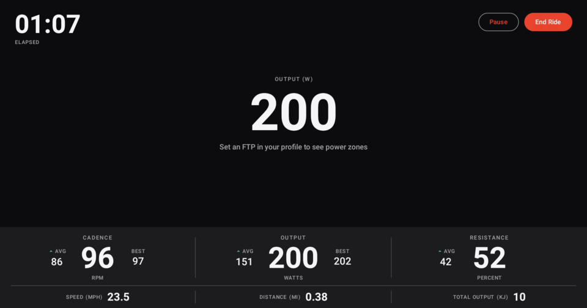
  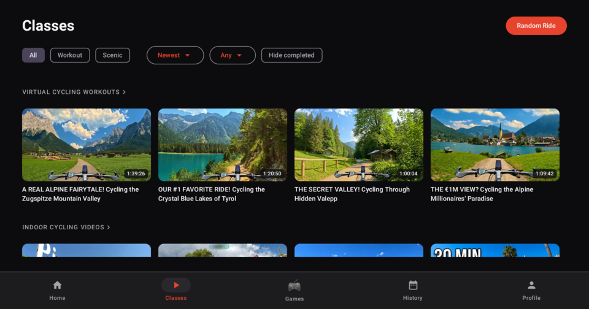
</p>

## New in 1.2

Seven new mini-games, circuits that change every ride, and a round of fixes for classes and your ride history.

- **Seven new games** — Watt Lane, Balloon Pump, Keepy Uppy, Power Grid, Ready for Launch, The Pull and Gate Crasher. See [The games](#the-games).
- **Fresh circuits every ride** — each slot in a circuit now draws from a pool of games that suit it, so the same 30-minute circuit plays differently each time.
- **Gentler targets** — the new games ask for about a third of your FTP to reach their main goal, so they're fun at a comfortable effort. Push harder for more stars.
- **Ride to your own music** — **Mute class** in the class player turns the class's sound off and lets your music app play. A class you open while music is playing starts muted.
- **Sharper class video** — classes now ask YouTube for a format the bike plays smoothly, so the picture holds its resolution instead of dropping to 480p.
- **Delete a ride** — the bin button on a ride's details removes it from your history.
- **Import your Peloton history** — **Profile → Backup & restore → Import Peloton history** adds the cycling rides from Peloton's workout-history CSV export to your history. Thanks to coyotemojo and Drewmiller1 for asking for these two.
- **About & support** — **Profile → About & support** shows what's new in your version, where to send feedback, and how to help fund the app.

## Support OpenRide

OpenRide is free and always will be. If it's made your rides better and you'd like to help keep it going, you can buy the developer a coffee:

<a href="https://buymeacoffee.com/digitalducktape"></a>

On the bike, **Profile → About & support** shows a QR code for the same page, so you can scan it with your phone.

## New in 1.1

Your music now has a place in the app, the bike's home screen is a setting you can switch on, and the heart-rate strap and the ride screens got a round of fixes.

- **Music player** — see what's playing in your music app, with its cover, song and artist and previous, play/pause and next buttons, in the top bar and on the Just Ride screen. Tested with Spotify, Apple Music, Pandora, SiriusXM and Plexamp. See [Music player](#music-player).
- **Music in the games** — game music steps aside while your own music plays, the **♪** button in the hub and in every game opens the player, and there's a Game music switch in the hub's settings.
- **Home screen setting** — **Profile → Device → Home screen → Turn on** makes OpenRide the screen the bike starts into, with no computer or `adb` commands. This fixes [#47](https://github.com/digitalducktape/openride/issues/47), and the home-screen part of [#63](https://github.com/digitalducktape/openride/issues/63) on the newer tablet. Pressing Home also no longer opens a second copy of the app.
- **Heart-rate strap** — it now connects reliably, reconnects by itself when the link drops, and shows **Connected • 72 bpm** on the pairing screen. Your heart rate also shows in the games.
- **Ride screen and display fixes** — bigger readings on the ride screens, form labels that no longer overlap their boxes, games that fill the bike's whole screen with no side bars, and one sensor warning that every screen shows and clears together, including when the bike's sensor board goes quiet.

## New in 1.0

This update brings a new Kart Race, a games hub for your workouts, better game graphics, music and sounds, and a new look for the whole app.

- **Games hub (BETA)** — pick games and circuits, build your own circuits, and play as many as you like. The whole session saves as one ride.
- **New game, Kart Race** — 3-lap races against seven rivals on four tracks. Pedal to drive, lean to steer, and add resistance to drift. Grab items along the way and see if you can be first across the line.
- **Better graphics and sound** — every game has a new look, new music and new sound effects, and they load faster too.
- **A new look for the app** — bigger controls, sensor and heart-rate status always in view, and simpler navigation with tabs along the bottom.
- **Easier to install** — you can now install OpenRide straight from [OpenPelo](https://github.com/doudar/Openpelo)'s app catalog. See [Getting the app](#getting-the-app).

## What it does

- **Live stats while you ride** — cadence, resistance, power, and speed, pulled straight from the bike itself, with no subscription required
- **A screen built for the bike** — big, simple controls readable from the saddle, tabs along the bottom, the bike's sensor and heart-rate status always in view, and each rider's own colour throughout
- **A profile for everyone in the house** — each rider gets their own name, picture, and workout history
- **A library of free classes** — a constantly-updating selection of cycling videos pulled in automatically, so there's always something new to ride to
- **A music player for your own music** — what's playing in Spotify, Apple Music, Pandora, SiriusXM, Plexamp and other music apps, with controls, right on the ride screen. [Details below](#music-player)
- **Mini-games (BETA)** — five pedal-powered games, including a full Kart Race, plus 20-, 30- and 45-minute game circuits and circuits you build yourself. [Details below](#mini-games-beta)
- **Ride history and personal bests** — a calendar of every past ride, plus your all-time best output, cadence, and duration
- **Bring your Peloton history with you** — import the workout-history CSV from your Peloton profile (**Profile → Import Peloton history**) and your past rides join your history, totals and personal bests. The export is a summary per ride, so imported rides have no graph
- **Export your ride data** — download any ride as a file (TCX or CSV) to keep or use elsewhere, so your data is always yours
- **Heart-rate strap and Bluetooth headphone support** — pair a heart-rate monitor, see your bpm on the ride screens and in the games, and headphone audio just works once paired

<p align="center">
  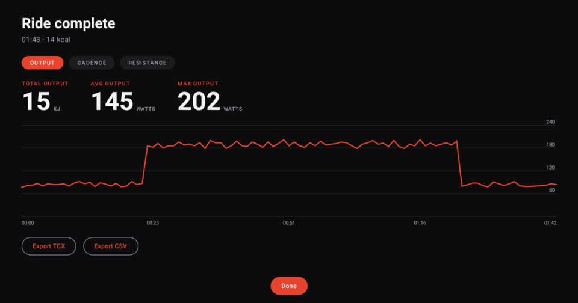
  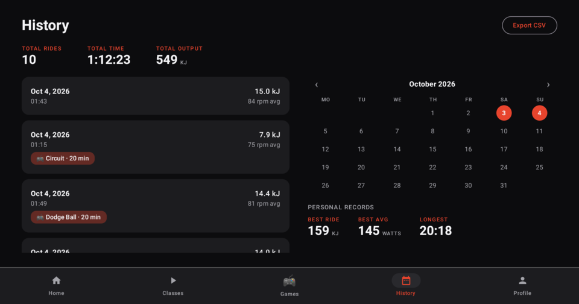
  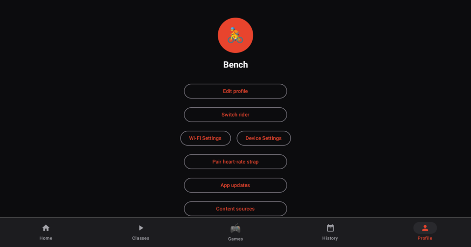
</p>

## Music player

OpenRide shows whatever your music app is playing: the cover, the song and the artist, with **previous**, **play/pause** and **next** buttons. It's a card in the top bar on every screen, and a larger panel beside the numbers on the Just Ride screen. It doesn't stream music itself, so you keep using your own app and your own account. Class videos have no player, because the class's own audio is the point.

It works with music apps that tell Android what they're playing. It's been tried on the bike with Spotify, Apple Music, Pandora, SiriusXM and Plexamp (a way to play your own library from a Plex server on a NAS).

**To set it up**, open **Profile → Music**:

1. **Music app** — pick the app you listen to. When nothing is playing, the player offers to open it.
2. **Now playing** — tap the row. Android needs you to give OpenRide **Notification access** before it will share what other apps are playing, and takes you to that screen.

Android words that permission as access to all notifications. OpenRide only uses it to find out what's playing: it never reads, stores or reacts to a notification, and nothing leaves the bike. You can turn it off again at any time in the same place.

Good to know:

- **Songs and playlists are picked in your music app.** OpenRide shows and controls what's playing, but Spotify, Apple Music and Pandora don't let other apps browse their libraries.
- **Players disappear when music stops for a while.** Most apps let go of their session after a pause, and the player goes with it. Press play in the music app and it's back.
- **In the games**, the **♪** button in the hub and in each game opens the player (a game pauses until you tap **Done**), and game music turns itself off while your music plays.

## Mini-games (BETA)

> [!IMPORTANT]
> **The mini-games are in BETA.** They are new, they have only had a little time on a real bike, and difficulty and scoring are still being tuned, so expect rough edges. **Feedback, ideas and pull requests are very welcome** — they are how we make this better. See [Help us make it better](#help-us-make-it-better) below.

Workouts that play like games. Tap **Enter Games** (the **Games** tab, or the *Games BETA* card on Home) and the Games hub opens: pick a game, a circuit or build your own, calibrate the camera once, and play as many as you like. The whole visit is saved as one ride. The bike's cadence, resistance and power are the controller: pedal to move, turn the resistance knob to score more, and the game keeps track of the rest. Each visit shows in your history like any other ride.

<p align="center">
  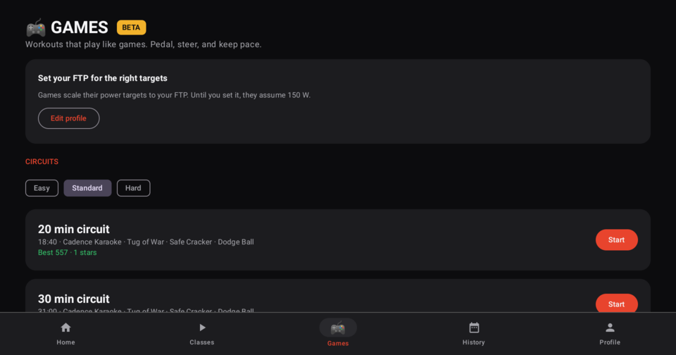
  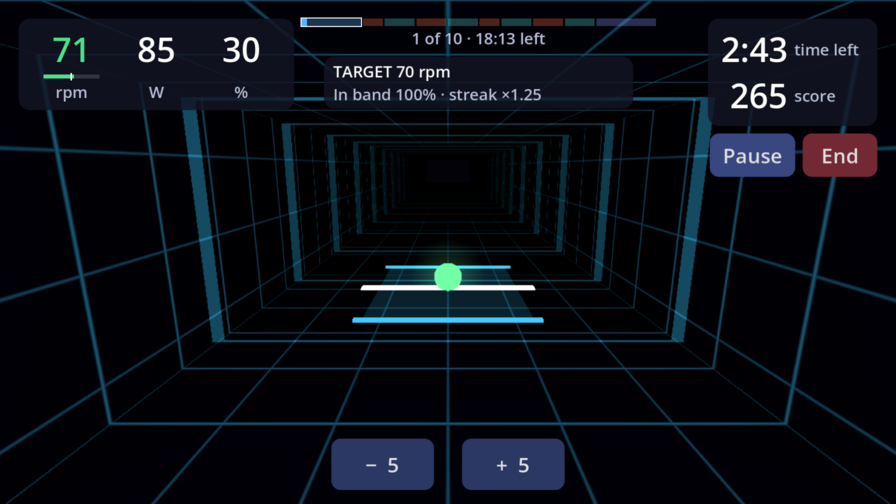
</p>

### The games

<p align="center">
  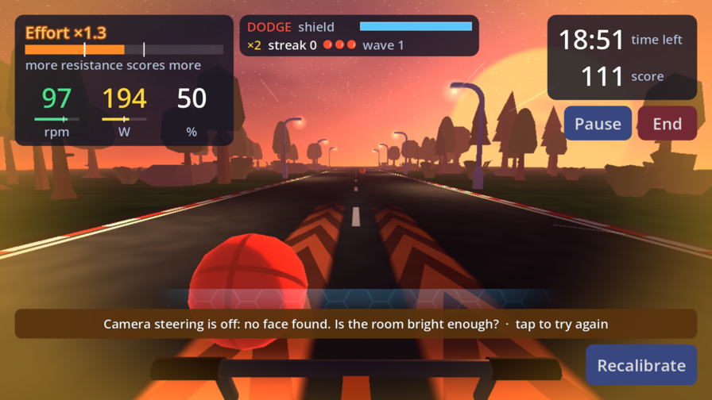
  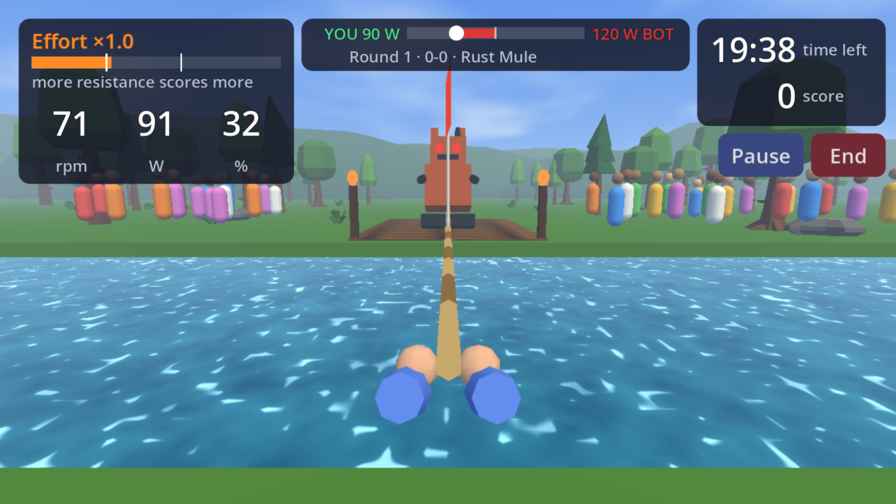
</p>
<p align="center">
  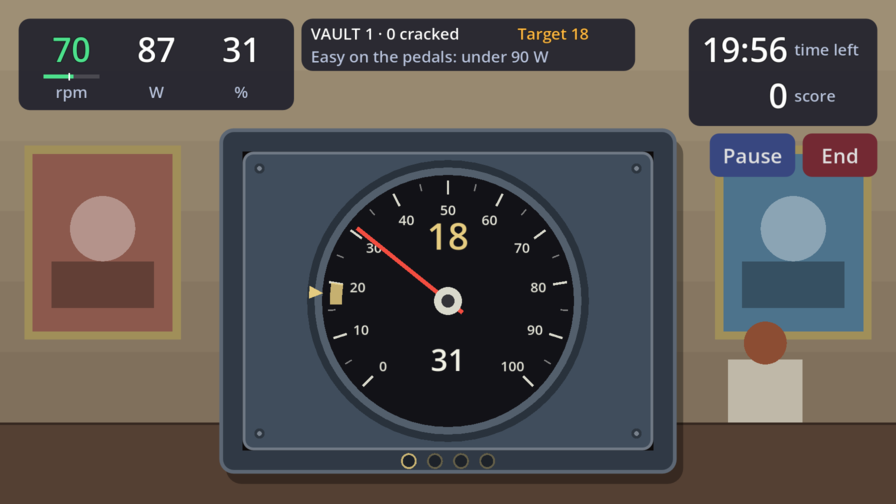
  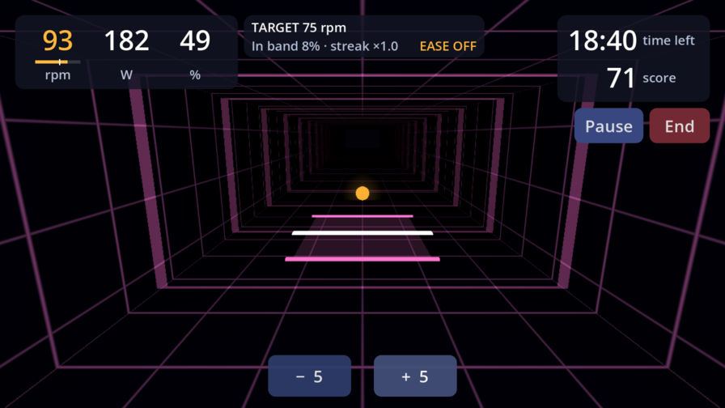
</p>
<p align="center">
  
  
</p>
<p align="center">
  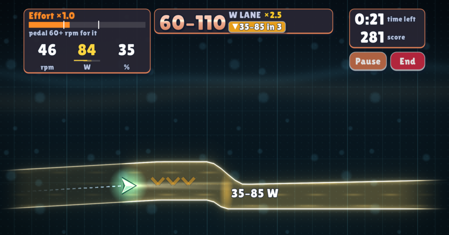
  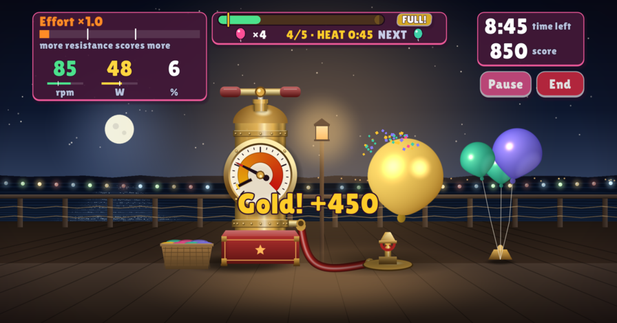
</p>
<p align="center">
  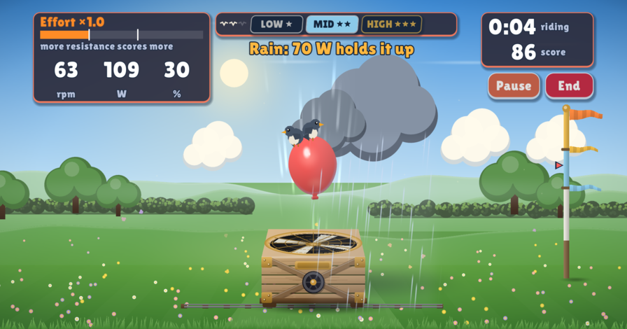
  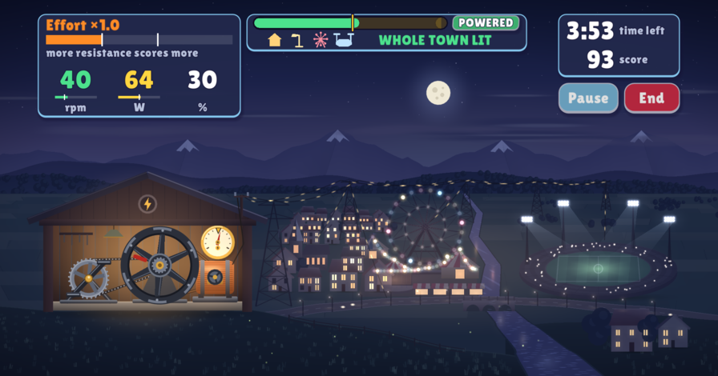
</p>
<p align="center">
  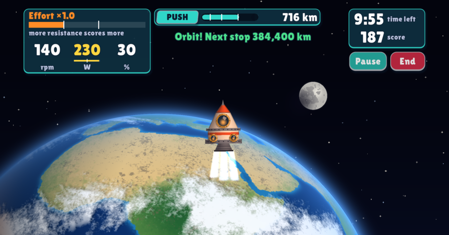
  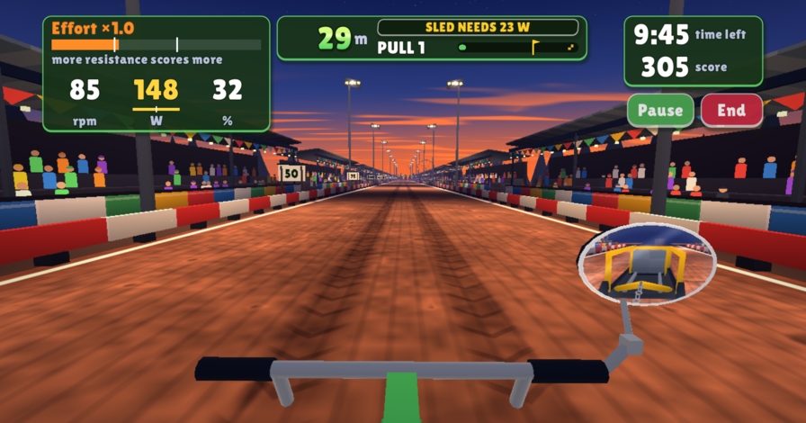
</p>
<p align="center">
  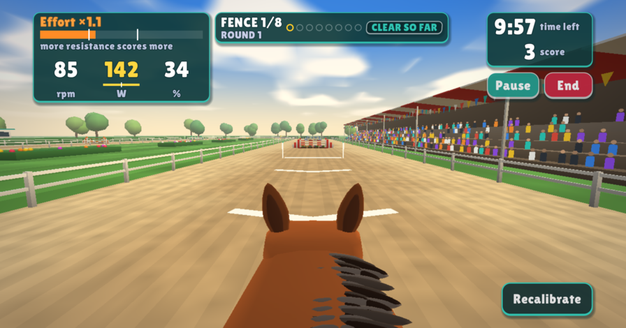
</p>

| Game | How it plays |
| --- | --- |
| **Dodge Ball** | A first-person ride down a sunset road. **Lean your head** to dodge balls coming at you — or switch to *Catch* mode and lean into the gold ones. Keep your cadence above the floor so your points count. Uses the camera. |
| **Tug of War** | A rope across a river and a robot on the other bank. Your watts against its watts: out-pedal the bot to win the round, and brace through its surges. Best-of-rounds matches. |
| **Safe Cracker** | A vault dial that you turn with the **resistance knob**. Hit each number and hold it to crack the safe, then move to the next — but keep your power under the cap or the alarm trips. |
| **Cadence Karaoke** | A neon tunnel with a target rpm set to the beat. Pedal at the target to keep the ball in the box; the **−** and **+** buttons set the pace you're comfortable with. |
| **Kart Race** | A Grand Prix of 3-lap races against seven rivals on four tracks. Pedal to drive, **lean your head** to steer, add resistance to drift and charge a boost, and tap to use the items you pick up. Pick your kart and starting track in the hub. Uses the camera. |
| **Watt Lane** | A glowing lane across the screen, and your watts set the arrow's height. Stay in the lane as it rises and falls, and catch the jumps it announces. A gentle warm-up. |
| **Balloon Pump** | Your pedalling drives an air pump. Push past the line to fill each balloon, which gets harder to fill near the end, then tie it off. Race to fill a set number, or fill as many as you can. |
| **Keepy Uppy** | Keep a balloon in the air over a fan your pedalling drives, while gusts, rain and birds push it down. Turn on *Steer* to **lean** and slide the fan under it. |
| **Power Grid** | Your bike turns a valley town's generator. Keep up with the evening's demand to light the houses, the street lamps, the funfair and the stadium, and push through storm repairs. |
| **Ready for Launch** | Fill the rocket's tank, then push hard at liftoff to climb through the clouds to orbit and on toward the Moon. One launch a round. |
| **The Pull** | A sled pull at a county fair. The sled gets heavier the further you drag it, so see how far you can get. Just Ride only. |
| **Gate Crasher** | Show jumping, seen from the saddle. Pedal to canter round the course and **stand up** on the bike at each fence's take-off line to clear it. Uses the camera. |

Each game can be played on its own as a **Just Ride** — for a set time, open-ended, or (for Dodge Ball, Tug of War and Safe Cracker) a set number of rounds — at Easy, Standard or Hard.

### Circuits

A circuit strings the games into a structured interval workout — warm-up, work and recovery segments, each with its own game — in **20, 30 or 45 minutes**, with a fresh mix of games every ride, or one you build yourself (up to 12 games and 90 minutes, saved as *My circuit 1-3*). A progress strip shows where you are, and the summary at the end lists every game and its result.

### Good to know

- **Resistance scores more.** In the effort games (Dodge Ball and Tug of War), points get a multiplier from 1.0× at light resistance (30% or less) up to 1.5× at 60% and above — but only while you're pedaling at 60 rpm or more, so grinding at a standstill doesn't count.
- **Targets follow your FTP.** Games scale their power targets to your FTP. Set it in **Profile → Edit profile**; until you do, they assume 150 W.
- **The camera is optional, and private.** Only Dodge Ball, Kart Race and Gate Crasher need it (and the optional lean modes in Tug of War and Keepy Uppy), to find where your head is or whether you're standing. It looks for a head position, and nothing is recorded or saved. If you don't allow the camera, circuits leave out the games that need it. A well-lit room helps.
- **Music and sound effects are generated on the device.** Game music turns itself off while you're playing your own music (you can set it to always on or off, and set volumes, in the hub's settings).
- **Stars and personal bests.** Each game awards up to three stars and remembers your best.

### Help us make it better

The games are the newest part of OpenRide, and the part that most needs real riders. The difficulty numbers are educated guesses, there are rough edges nobody has hit yet, and there are plenty of ideas still to try. If you ride them, **please tell us what you think**:

- **Feedback and bugs** — [open an issue](https://github.com/digitalducktape/openride/issues/new). Was a game too hard or too easy? Did the camera lose you? Did the music or a screen feel off? Tell us your bike (Gen 2 or Bike+) and what happened.
- **Ideas** — a new game, a new circuit, a better way to score? [Open an issue](https://github.com/digitalducktape/openride/issues/new) and describe it. The [tuning and follow-up list](https://github.com/digitalducktape/openride/issues/49) shows what's already planned.
- **Pull requests** — very welcome, from a typo to a whole new game. [docs/GAMES.md](docs/GAMES.md) explains how the games are built and how to add one (they're a [Godot](https://godotengine.org/) project). Small, focused PRs are easiest to review, and it's worth opening an issue first for anything big.

Please keep any new game original: mechanics can be inspired by classic ideas, but names, art, audio and code should be your own or under a permissive licence.

## Getting the app

OpenRide isn't in an app store, but you don't need to be technical to install it: it's listed in [OpenPelo](https://github.com/doudar/Openpelo)'s app catalog, so installing it takes a few clicks.

### Install with OpenPelo (recommended)

1. **Set up OpenPelo** on your computer and connect it to the bike, following [its instructions](https://github.com/doudar/Openpelo#connect-a-device). OpenPelo brings its own connection tools; you don't need to install anything else.
2. **Pick OpenRide.** In OpenPelo, choose the bike under **Target Device**. In **Compatible applications**, open the **Fitness** category (or **All apps**) and tick **OpenRide**.
3. **Click Install selected.** OpenPelo downloads the latest OpenRide release from this repo and installs it; **ADB activity** shows the progress.
4. **Open OpenRide** on the bike. It starts on a "Who's riding?" screen: add a rider and you're in.

### Other ways to install

- **A downloaded APK:** grab the latest `openride-real-*.apk` from the [Releases page](https://github.com/digitalducktape/openride/releases/latest), then use OpenPelo's **Install local APK**, or `adb install -r openride-real-*.apk` if you already use `adb`.
- **Build it yourself:** you'll need Java 21, the [Godot 4.7.2](https://godotengine.org/download/archive/) editor (the mini-games are a Godot project; see [docs/GAMES.md](docs/GAMES.md)) and a copy of this repo. Then, in a terminal opened to that folder:

  ```sh
  export GODOT_BIN=/Applications/Godot.app/Contents/MacOS/Godot   # wherever Godot 4.7.2 is
  ./gradlew :app:assembleDebugReal
  ```

  The app lands at `app/build/outputs/apk/debugReal/app-debugReal.apk`; install it as above.

### Make it the bike's home screen (optional)

To make OpenRide the screen that greets you when the bike turns on, open **Profile → Device → Home screen** and tap **Turn on**, then choose OpenRide in Android's prompt. **Turn off** puts the bike's previous home app back. Making sure a Peloton software update doesn't undo this, and what to do if Peloton's own screen still comes up over OpenRide on newer software, are covered step by step in **[docs/INSTALL.md](docs/INSTALL.md)**. Please read it in full before starting: the order of steps there matters.

### Staying up to date

Once it's installed, OpenRide checks this repo's [Releases](https://github.com/digitalducktape/openride/releases) on its own each time it launches, and shows a notice at the top of the screen when a newer build is available. Tap it (or go to **Profile → App updates**) to download and install; no computer needed. Reinstalling from OpenPelo's catalog also gets you the latest release. See [docs/INSTALL.md](docs/INSTALL.md#in-app-updates-t22--22) for details.

## Privacy

Sharing usage metrics is **off until you say yes**: OpenRide asks once, and nothing is sent otherwise. If you opt in, it sends anonymous counts of which screens and features get used, so we know what to fix. No names, heart rate, power, or song or artist info. To turn it off, go to Profile, then Device, then Share usage metrics. [docs/TELEMETRY.md](docs/TELEMETRY.md) lists exactly what is sent.

## For developers

The rest of this section is technical detail for anyone contributing to the code — feel free to skip it otherwise.

- Kotlin + Jetpack Compose, single-activity, `minSdk 29` (the Bike+'s Android 10), package `dev.digitalducktape.openride`
- Sensor access sits behind a `BikeDataSource` abstraction with a `MockBikeDataSource` (simulated ride) so all UI/logic development runs in a standard emulator; only the real system-service binding needs the physical bike
- Room database: `Profile` / `Ride` / `RideSample` (per-second samples — required for TCX export)
- Content browser fetches per-channel YouTube RSS (`/feeds/videos.xml?channel_id=…`) on-device: no API key, no quota, no backend
- The music player reads other apps' Android media sessions (`core/music/NowPlayingMonitor`, which needs Notification access via an empty `NotificationListenerService`), with no per-service SDKs or accounts; the games reach it through the bridge's `now_playing` and `music_control` messages
- Mini-games are a Godot 4.7.2 project in `games/`, embedded through `GameHostActivity` and the `OpenRideBridge` plugin; APK builds export it, so they need `GODOT_BIN` pointing at the Godot editor (unit tests don't) — see [docs/GAMES.md](docs/GAMES.md)
- Continuous integration: every pull request and every push to `main` runs the Kotlin unit tests (`./gradlew :app:testDebugUnitTest`) and the Godot tests (the GdUnit4 suites and the headless `sim_*` playthroughs) on GitHub Actions; see [.github/workflows/ci.yml](.github/workflows/ci.yml)

## License

OpenRide is released under the [Apache License 2.0](LICENSE). Attributions for
prior community work and bundled dependencies are in
[THIRD_PARTY_NOTICES.md](THIRD_PARTY_NOTICES.md).

## Independent project — not affiliated with Peloton

OpenRide is an independent, non-commercial project. It is **not affiliated with,
authorized, sponsored, or endorsed by Peloton Interactive, Inc.** "Peloton" and
"Peloton Bike" are trademarks of their owner, used here only to describe the
hardware OpenRide runs on.

OpenRide ships **no Peloton source code, artwork, branding, audio, video, or
class content**. It reads the bike's own sensor values through an existing,
unprotected on-device service (no root, no firmware modification) purely for
interoperability, and streams third-party workout videos through YouTube's
official player. Any UI resemblance is limited to common layout and interaction
patterns. For the reverse-engineering and trademark basis, see
[docs/INTEROP.md](docs/INTEROP.md).
